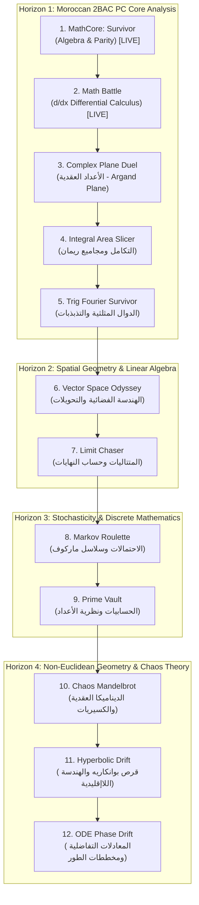

# Math Arcade: Autonomous Grand Roadmap (Project Miracle)

## 1. Core Engineering Philosophy
* **Zero Bloat, Zero Dependencies**: 100% pure web standards (Vanilla ES Modules, HTML5 Canvas, Web Audio API, Gamepad API). No NPM build steps, no webpack, no bundle bloat.
* **PlayStation Exclusivity**: All interactive controls are strictly engineered for PlayStation DualSense / DualShock (`✕ Cross`, `◯ Circle`, `▢ Square`, `△ Triangle`, L1/R1, L2/R2, D-Pad, Left/Right Stick) with haptic rumble.
* **Moroccan 2BAC PC/SM Pedagogical Rigor**: Every game is an intuitive, visual, and mathematically rigorous sandbox modeling actual mathematical concepts with zero deduction compromises.
* **Autonomous Self-Healing & Evolution**: The project evolves autonomously twice daily (Phase Alpha: Creation; Phase Omega: Hardening) while maintaining a strict quality gate.

---

## 2. The Four Horizons: 12 Planned Masterpiece Games

---

## 3. Horizon 1 Detailed Specifications

### Game 1: MathCore Survivor (LIVE)
* **Mathematical Core**: Linear equations ($ax = b$), parity invariants ($2k, 2k+1$), divisibility rules ($3k$), Cartesian kinematics.
* **PlayStation Mapping**: Left Stick flight, `✕, ◯, ▢, △` operations, R2 EMP shockwave, L2 parity turrets.

### Game 2: Math Battle: Calculus Showdown (LIVE)
* **Mathematical Core**: Power rule ($\frac{d}{dx} x^n = n x^{n-1}$), trigonometric cycles ($\sin \to \cos \to -\sin \to -\cos \to 0$), exponential invariant ($\frac{d}{dx} e^x = e^x$), constant annihilation ($\frac{d}{dx}(1) = 0$).
* **HUD**: Live derivation lifecycle bar with active stage tracker.

### Game 3: Complex Plane Duel (Next Focus)
* **Mathematical Core**:
  * Complex affixes in the Argand-Cauchy plane ($z = x + iy$).
  * Modulus and argument ($|z| = \sqrt{x^2 + y^2}$, $\theta = \arg(z)$).
  * Geometrical transformations: Translation ($z' = z + b$), Rotation by angle $\theta$ ($z' = e^{i\theta} z$), Homothety ($z' = k z$).
  * Roots of unity ($z^n = 1$) spawning symmetric shield formations!
* **Mechanics**: Player commands a complex core craft that rotates and expands laser barriers by applying complex multiplications.

### Game 4: Integral Area Slicer
* **Mathematical Core**: Definite integrals $\int_a^b f(x) dx$, upper and lower Darboux-Riemann sums, the Fundamental Theorem of Calculus.
* **Mechanics**: Players dynamically slice curves into rectangular Riemann partitions; tighter partition widths ($\Delta x \to 0$) unleash amplified resonance beams.

### Game 5: Trig Fourier Survivor
* **Mathematical Core**: Harmonic oscillations, phase shift $\phi$, frequency modulation, Fourier harmonic series synthesis ($f(t) = \sum a_n \sin(n \omega t)$).

---

## 4. The Daily Evolution Protocol (Morning & Evening)

1. **Morning Run (05:00 UTC) - Phase Alpha (Creation & Feature Build)**:
   * Selects next game or major feature from the active Sprint.
   * Scaffolds modular directories (`css/`, `js/`, `README.md`, `index.html`).
   * Implements mathematical engine and PlayStation controller bindings.
   * Validates syntax and registers into `games.json`.
   * Pushes to GitHub and verifies live deployment.

2. **Evening Run (17:00 UTC) - Phase Omega (Hardening & Quality Assurance)**:
   * Deep performance audit (120 FPS target, memory leaks, touch event handling).
   * Refines mathematical accuracy, adds pedagogical tips and formula HUDs.
   * Tunes audio synthesis and dual-rumble haptic pulses.
   * Compacts logs and updates `STATE.json` and `SPRINT.md`.
   * Sends a high-level briefing to the Owner on Telegram.
